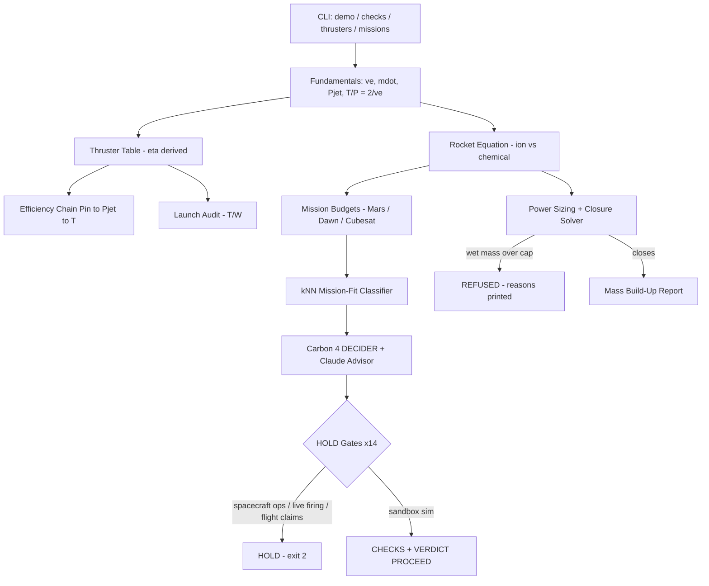
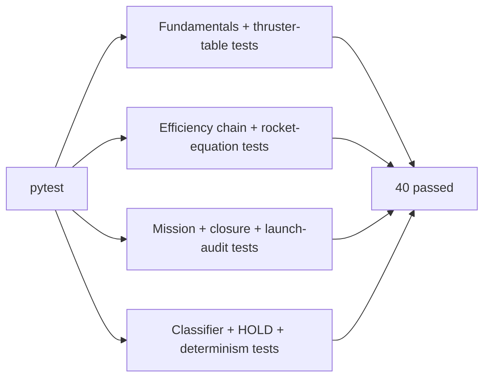
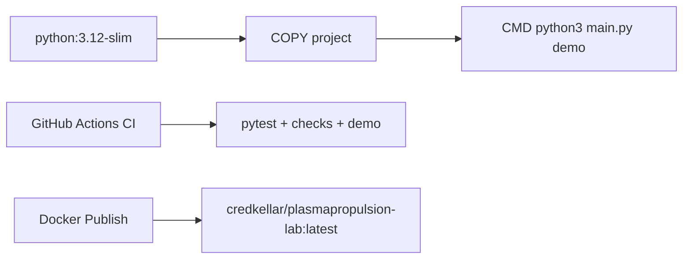

# PlasmaPropulsion-Lab 🚀⚡

**Ion & Hall Thruster Propulsion Lab** — an educational electric-propulsion lab in ONE pure-Python file, by Darion Kellar. The fundamentals done honestly: exhaust velocity **ve = Isp × g0**, thrust **T = ṁ × ve**, jet power **P = ½ṁve²**, and the iron trade **T/P = 2/ve** — the higher the specific impulse, the weaker the push per kilowatt. A **thruster table** of labelled published-class engines (NSTAR, NEXT, SPT-100, X3) with efficiency *derived* from the nameplate numbers so the table can never contradict the physics, the **rocket equation** with the headline comparison (at Δv = 10 km/s a 1,000 kg craft needs **220 kg** of propellant on ion vs **896 kg** on chemical), **labelled mission budgets** (Mars cruise, a Dawn-style 11 km/s tour, cubesat station-keeping), **solar power sizing** with a mission-closure solver that **REFUSES** a design whose wet mass busts its cap, and a thrust-to-weight audit proving electric propulsion **cannot launch anything**. Simulation and learning only — every real-spacecraft operation and every flight claim sits behind a permanent HOLD gate (14 total). 🔒


> ℹ️ The two workflow badges above are the **live** GitHub Actions badges for this repo — they light up as soon as the `ci.yml` and `docker-publish.yml` files from the paste pack are pasted into `.github/workflows/`.

## 🧰 Tech Stack Badges & Full Architecture Tech Stack

### 💻 Core Programming Languages & Core Systems


- 🐍 Python 3.12, pure standard library (`math`, `hashlib`, `json`, `sys`) — ONE file: `main.py`
- 🚀 Propulsion core: exhaust-velocity / mass-flow / jet-power identities, derived-efficiency thruster table, Tsiolkovsky rocket equation (fraction, wet-for-dry inversion, round-trip Δv), burn-time solver, solar 1/r² array sizing, mission-closure mass build-up with REFUSAL path, thrust-to-weight launch audit
- 🧠 TinyML kNN mission-fit classifier (from scratch, stdlib) on (mission Δv, log₁₀ days available, log₁₀ power available)
- 🧑‍⚖️ Advisory seats inside `main.py`: Gemini Carbon 4 DECIDER (names-only, tighten-only, sha256 trace), Muse advisor (can_override_hold = False), Google Flow plan-only (rendered = False, live = 0)

### ⛓️ Web3 & Infrastructure

Not used — this lab is an offline physics simulation. No blockchain, no Web3 libraries, no network calls of any kind.

### ⚙️ Platform Support & Hardware Architecture


- 🖥️ Runs anywhere Python 3.12 runs — Linux, macOS, Windows, any CPU architecture
- 🚫 Controls **no hardware**: no thrusters, power supplies, vacuum chambers, or spacecraft (all behind HOLD gates)

### ⚡ Low-Level Infrastructure & Performance


- 🚀 Zero dependencies, zero network, zero install friction for the lab itself
- 🎯 Deterministic end to end: run it twice, get byte-identical output
- 🔢 Closed-form physics throughout — the only iteration is the kNN sort; every mission number is an exponential or a ratio away

### 🛠️ DevOps & Build Tools


- 🐳 Docker image (`python:3.12-slim`), target: `credkellar/plasmapropulsion-lab:latest`
- ⚙️ GitHub Actions CI + Docker Publish workflows — delivered in the paste pack for `.github/workflows/`

### ☁️ Cloud Providers

Not used — this lab runs fully offline on your own machine or in a local Docker container. No cloud account, no API keys, no hosted services.

## What this does?

1. ⚖️ **Fundamentals, exact** — ve = Isp × g0, T = ṁ·ve, P_jet = ½ṁve². Divide thrust by jet power and the mass flow cancels: **T/P = 2/ve**. At Isp 1,600 s a perfect kilowatt buys 127.5 mN; at 4,100 s only 49.7 mN. The most propellant-sipping engines are the feeblest pushers, and the lab shows the arithmetic instead of asserting it.
2. 🏭 **Thruster table, labelled** — four published-class engines: NSTAR-class gridded ion (3,100 s, 92 mN @ 2.3 kW), NEXT-class (4,100 s, 236 mN @ 6.9 kW), SPT-100-class Hall (1,600 s, 83 mN @ 1.35 kW), X3-class Hall (2,600 s, 5.4 N @ 102 kW). Efficiency is **derived** (η = P_jet/P_in = 0.61 / 0.69 / 0.48 / 0.67) — the table is forbidden from contradicting section 1.
3. 🔗 **Efficiency chain** — Pin → P_jet → thrust, every link printed: NEXT turns 6,900 W in into 4,744.5 W of jet and 2,155.5 W of losses, and the chain reconstruction T = 2ηP/ve is asserted to reproduce the nameplate thrust exactly.
4. 🎯 **THE HEADLINE** — the rocket equation on one craft at one Δv: 1,000 kg, 10 km/s. Ion (4,100 s): **220.19 kg** propellant, 22.0% of wet mass. Chemical (450 s): **896.28 kg**, 89.6%. The 676 kg difference is the entire reason electric propulsion exists.
5. 🗺️ **Mission budgets, labelled models** — Mars cruise: 800 kg, 6.0 km/s on NEXT → 110.90 kg of xenon and **218.7 days** of continuous burn. Dawn-style tour: 1,218 kg, 11 km/s on NSTAR → 369.79 kg and **~3.9 years** of accumulated thrust at 6.5 m/s of Δv per day. Cubesat station-keeping: 38.2 g of xenon per year vs 135.2 g chemical.
6. ☀️ **Power system sizing** — sunlight falls as 1/r²: at Mars distance (1.524 AU) a 100 W/kg array makes 43.1 W/kg. The closure solver stacks payload + bus + array + thruster system, inverts the rocket equation for wet mass, and renders a verdict.
7. 🚫 **A design that REFUSES** — an X3 tug at Mars distance: the 102 kW array balloons to 2,369 kg, wet mass hits 5,569 kg against a 3,000 kg cap → **REFUSED**, with both reasons printed (cap busted, power system outweighs payload + bus). A paper spacecraft that cannot close is reported, not hidden.
8. 🛫 **The launch audit** — thrust-to-weight for the whole table on a 1,000 kg craft: best is the X3 at **5.5×10⁻⁴**. Hovering needs T/W > 1. Electric propulsion is four-plus orders of magnitude short *by construction* — chemical rockets launch, ion engines take over in orbit.
9. 🏷️ **kNN mission-fit classifier** — labels a (Δv, time, power) point `ideal` / `workable` / `wrong-tool`: the Dawn tour and Mars cargo are ideal, station-keeping and orbit raising are workable, a surface launch and a 3-day lunar dash are the wrong tool — no efficiency survives a deadline the thrust cannot meet.
10. 🧠 **Advisory seats + checks** — Carbon 4 DECIDER with sha256 trace, Muse advisor, Google Flow plan-only, and a built-in CHECKS suite (66 checks).

## 🗺️ How it works — diagram per script

### `main.py` — the whole lab



### `tests/test_main.py` — verification



### `conftest.py` — test path setup


### `Dockerfile` + CI — container & workflow flow



## Why is this cool?

1. 🚀 It puts the whole field in one line — T/P = 2/ve — and then *proves* the line against four real engine classes whose efficiencies it derives instead of copies.
2. 🎯 The headline comparison is brutal and fair: same craft, same 10 km/s — 220 kg of xenon vs 896 kg of chemical propellant. No adjectives needed.
3. 🗓️ It prices missions in the currency ion drives actually spend: calendar. The Dawn-style tour needs ~3.9 *years* of accumulated thrust; the Mars cruise burns for 219 straight days.
4. ☀️ The power plant is part of the engine: sunlight thinning to 43% at Mars turns a 69 kg array into a 160 kg array, and the lab makes the mission pay for it.
5. 🚫 It refuses its own design: the X3 tug at Mars distance gets a printed REFUSAL with reasons — most planning tools quietly let impossible spacecraft through.
6. 🛫 It kills the "why not launch on ion?" question with one ratio: best thrust-to-weight 5.5×10⁻⁴ vs the >1 that hovering demands.
7. 🛰️ A cubesat sips 38 grams of xenon a year to stay in orbit — and the lab shows the chemical bill (135 g) it is beating, per year, per gram.
8. 🏷️ A tiny from-scratch ML classifier learns the field's folk wisdom: high Δv + long time = ideal; any Δv + no time = wrong tool.
9. 🔢 Every number is checkable: efficiencies derived, the rocket equation round-tripped, the efficiency chain asserted to reconstruct nameplate thrust to 1e-12.
10. 🎯 Deterministic end to end: run it twice, get byte-identical output — propulsion planning you can diff.

## What problems this solves?

1. ❌ **Problem:** Isp gets quoted alone, as if higher is simply better. ✅ **Solution:** The fundamentals module pairs every Isp with its thrust-per-kilowatt cost via T/P = 2/ve, so the trade is printed next to the brag.
2. ❌ **Problem:** Thruster tables mix measured, marketing, and misremembered numbers. ✅ **Solution:** The four engines are labelled published-class reference values, and efficiency is derived from the three nameplate numbers — an inconsistent row would fail the lab's own checks.
3. ❌ **Problem:** "Ion is more efficient" is too vague to plan with. ✅ **Solution:** The rocket-equation module turns it into kilograms: 220 vs 896 kg on the same craft at the same Δv, with the fraction formula depending only on Δv and Isp.
4. ❌ **Problem:** Mission sketches forget the burn takes forever. ✅ **Solution:** Every budget prints continuous burn time from propellant ÷ ṁ — 218.7 days for Mars, ~3.9 years for the Dawn tour — next to the propellant it saved.
5. ❌ **Problem:** The solar array is treated as weightless. ✅ **Solution:** Array mass is computed from a labelled specific power with the 1/r² sunlight law applied, and it lands in the dry mass before the rocket equation runs.
6. ❌ **Problem:** Paper missions "close" because nobody checks. ✅ **Solution:** The closure solver compares wet mass against a stated cap and REFUSES with named reasons when the design busts it or the power system outweighs the payload.
7. ❌ **Problem:** People ask why ion engines don't launch rockets. ✅ **Solution:** The launch audit computes thrust-to-weight for the whole table (best 5.5×10⁻⁴) against the T/W > 1 that hovering requires — four orders of magnitude, shown.
8. ❌ **Problem:** Station-keeping propellant is invisible until the satellite dies. ✅ **Solution:** The cubesat budget prices a year of drag make-up in grams — 38.2 g ion vs 135.2 g chemical — the arithmetic that decides satellite lifetimes.
9. ❌ **Problem:** Propulsion code usually needs numpy / scipy installs. ✅ **Solution:** Pure standard library — runs anywhere Python 3.12 runs, zero pip installs for the lab itself.
10. ❌ **Problem:** Planning tools quietly imply flight readiness. ✅ **Solution:** Thruster figures are labelled reference-class, missions are labelled model budgets, closure is labelled not-an-approval, and 14 HOLD gates return exit code 2 for every real operation and flight claim.

## How to install this?

1. 📋 Clone or download this project folder.
2. 🐍 Make sure Python 3.12+ is installed: `python3 --version`
3. ▶️ Run the full demo + checks (no arguments needed):

```bash
python3 main.py
```

4. 🧪 Run the test suite:

```bash
pip install pytest
python3 -m pytest -q
```

5. 🎛️ Try the other commands:

```bash
python3 main.py checks       # 66 built-in checks
python3 main.py fundamentals # Isp -> ve -> thrust-per-kW trade table
python3 main.py thrusters    # the 4-engine table as JSON (eta derived)
python3 main.py efficiency   # Pin -> Pjet -> thrust chain as JSON
python3 main.py rocket       # THE HEADLINE: ion vs chemical at 10 km/s
python3 main.py missions     # Mars / Dawn / cubesat budgets as JSON
python3 main.py power        # closure solver: one CLOSES, one REFUSED
python3 main.py launch       # thrust-to-weight launch audit as JSON
python3 main.py classify     # kNN mission-fit verdicts
python3 main.py brains       # Carbon 4 + Muse + Flow seats
python3 main.py holds        # list all 14 HOLD gates
python3 main.py hold-demo    # exits 2 - gated actions stay HOLD
```

6. 🐳 Or run it in Docker:

```bash
docker build -t credkellar/plasmapropulsion-lab:latest .
docker run --rm credkellar/plasmapropulsion-lab:latest
```

## Requirements

- 🐍 Python 3.12 or newer
- 📦 Dependencies: **none** (standard library only)
- 🌐 Network: **none** — fully offline
- 🧪 For tests only: `pytest`
- 🐳 Optional: Docker

## FULL project structure tree

```text
plasmapropulsion-lab/
├── main.py                  # the whole lab: fundamentals, thruster table, efficiency chain, rocket equation, missions, power sizing + closure, launch audit, classifier, seats, HOLD gates
├── conftest.py              # puts the project root on sys.path for tests
├── tests/
│   └── test_main.py         # 40 pytest tests: fundamentals, thrusters, chain, rocket equation, missions, closure, launch, classifier, gates, determinism
├── assets/
│   └── cover.png            # README cover image (2736 x 912)
├── Dockerfile               # python:3.12-slim, runs the demo
├── .gitignore               # __pycache__, .pytest_cache, *.pyc
└── README.md                # this file
```

> 📦 Delivered separately as paste packs (not in this tree): `.github/workflows/ci.yml` + `docker-publish.yml`, and the Docker Hub pack (100-char description, 350-char About, overview, categories).

## 🔒 HOLD gates — all 14, permanent

| Gate | Rule |
|---|---|
| real_spacecraft_operation | No operation or commanding of any real spacecraft, ever |
| live_thruster_firing | No firing instructions for real ion / Hall hardware; this lab computes, it does not operate |
| flight_plan_execution | Mission budgets here are educational models, not flight products or navigation data |
| launch_capability_claim | Electric thrust is ~1e-4 of weight class; nothing here can launch anything, and no claim says otherwise |
| faster_mission_claim | Ion burns take months to years; no claim that electric propulsion is the fast option |
| commercial_product_claim | Educational lab, not a commercial propulsion product or service |
| guaranteed_performance_claim | No guaranteed mission performance; every budget carries its labelled assumptions |
| crewed_mission_safety_claim | No crewed-mission safety claims; these toy budgets certify nothing for human flight |
| weapons_application_claim | No weapons application guidance of any kind |
| hardware_fabrication_live | No thruster fabrication instructions; ion optics and discharge chambers are not a home build |
| high_voltage_operation_live | Ion thrusters run kilovolt beam supplies; no live high-voltage operating instructions |
| propellant_handling_live | No xenon / iodine propellant handling instructions for real hardware |
| investment_claim | No investment advice about propulsion or space companies |
| mission_design_approval_claim | A budget that "closes" here is a labelled model result, not an approved mission design |

🧑‍⚖️ **Seats:** Gemini Carbon 4 DECIDER (MAP→MODEL→STRESS→DECIDE, names-only, tighten-only, sha256 trace) · Muse advisor (can_override_hold = False) · Google Flow plan-only (rendered = False, live = 0).

✅ **Verification:** pytest 40 passed · CHECKS 66/66 · double-run byte-identical · hold-demo exits 2.

## 🧒 5th-grade English section

Imagine pushing a huge boat with one finger. You push very, very gently — but you never stop, day and night, for months. Slowly, the boat ends up going faster than a speedboat that burned all its fuel in one big roar. That is how an ion engine works. 🚀

- A normal rocket throws lots of heavy gas out the back, fast. It needs a **huge** tank, and the tank is empty in minutes. ⛽
- An ion engine throws out only a **tiny whisper** of gas — but the whisper leaves at an incredible speed, so each tiny bit counts for a lot.
- Because it sips its fuel, an ion spaceship can keep pushing for **years**. One real spaceship, called Dawn, visited **two** different asteroids on one tank this way! 🪨
- But the push is *so* gentle that an ion engine could never lift anything off the ground. It is about **ten thousand times too weak** for that. It only starts work once a normal rocket has carried it into space. 🛫
- The Sun powers it, through big solar wings. Fly farther from the Sun and the sunlight gets weaker — so far-away spaceships need **bigger wings**, and sometimes the wings get so heavy the trip stops making sense. This project checks that math and says "no" when a trip does not add up. ☀️
- This project is a **pretend lab on a computer**. It does the math of ion engines — it does not fly anything or touch anything real. 💻

---

MIT © 2026 Darion Kellar · PlasmaPropulsion-Lab — educational simulation only 🚀
